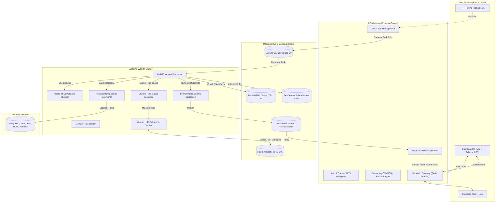
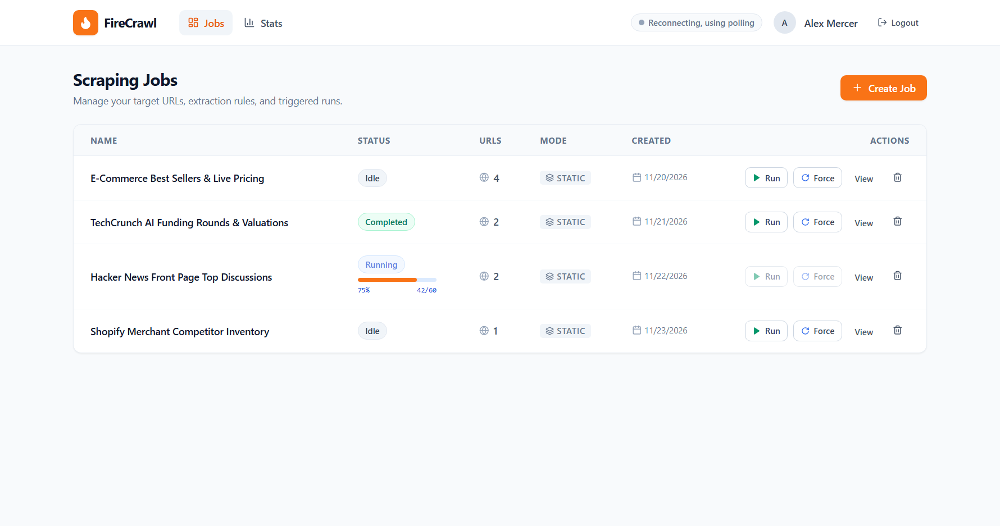
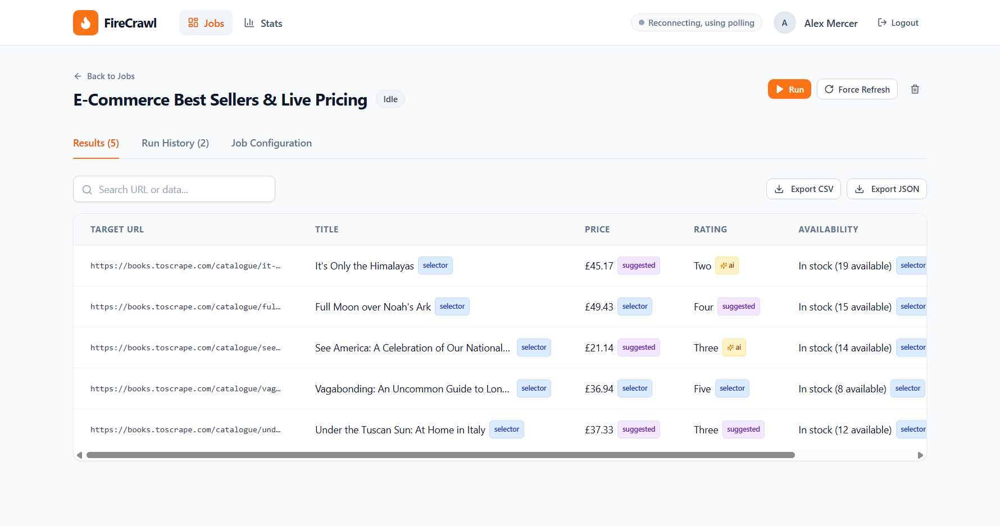
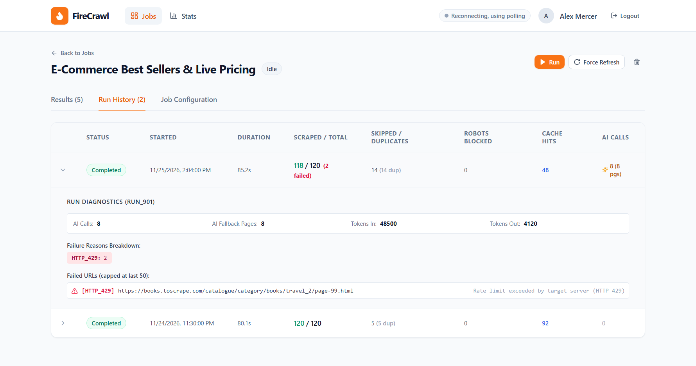
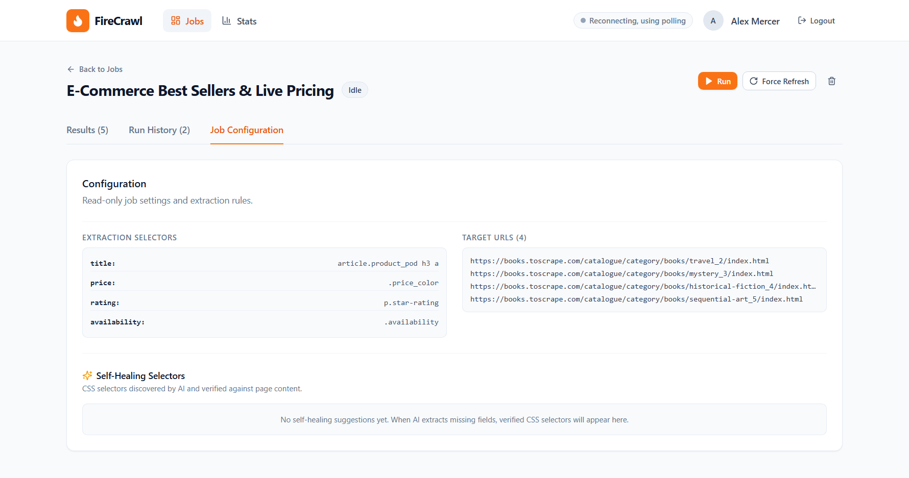
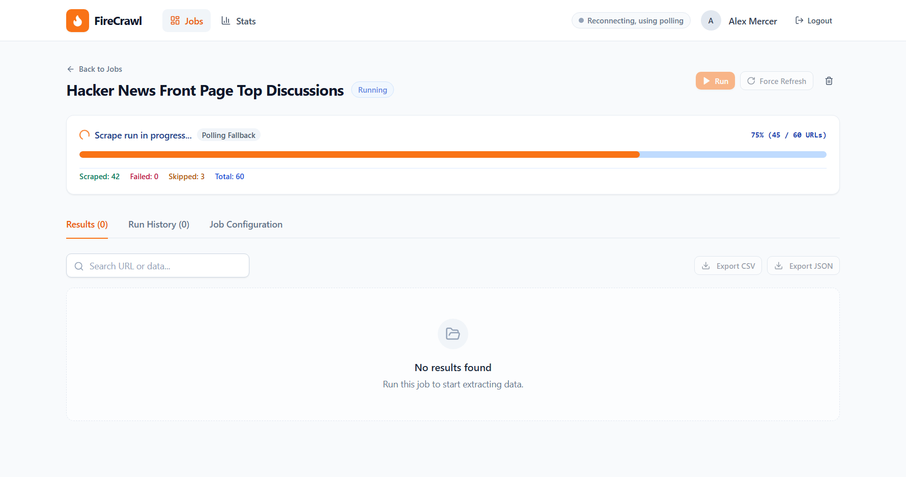
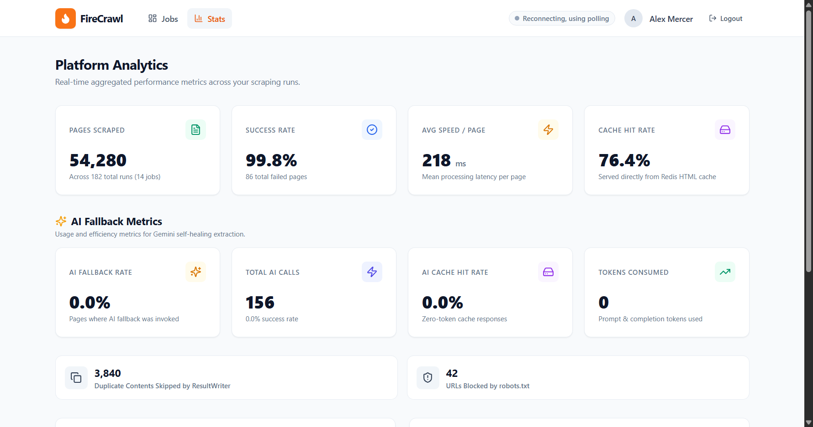

# FireCrawl

<p align="center">
  <strong>Distributed, High-Throughput Web Scraping & Data Extraction Engine</strong><br>
  Featuring Real-Time WebSocket Telemetry, Redis Caching, Rate Limiting, and Self-Healing AI Selectors
</p>

<p align="center">
  
  
  
  
  
  
  
  
  
  
</p>

---

## Table of Contents

- [Overview & Key Highlights](#overview--key-highlights)
- [System Architecture](#system-architecture)
- [Monorepo Structure](#monorepo-structure)
- [Core Features & Deep Dive](#core-features--deep-dive)
  - [1. Self-Healing AI Fallback (Gemini LLM)](#1-self-healing-ai-fallback-gemini-llm)
  - [2. Multi-Layer Efficiency & Anti-Ban Protection](#2-multi-layer-efficiency--anti-ban-protection)
  - [3. Real-Time Distributed Telemetry (Socket.io)](#3-real-time-distributed-telemetry-socketio)
  - [4. Enterprise Security & Hardening](#4-enterprise-security--hardening)
- [Benchmark Results: 100% LLM Cost Reduction](#benchmark-results-100-llm-cost-reduction)
- [REST API Reference](#rest-api-reference)
- [Frontend Dashboard & Observability](#frontend-dashboard--observability)
- [Getting Started & Local Setup](#getting-started--local-setup)
- [Testing & Quality Assurance](#testing--quality-assurance)
- [Environment Variables Reference](#environment-variables-reference)
- [Documentation & Deep Dives](#documentation--deep-dives)

---

## Overview & Key Highlights

**FireCrawl** is a distributed web scraping and unstructured data extraction platform engineered to solve the most persistent challenges of large-scale web scraping: **brittle CSS selectors, target server rate-limiting, runaway AI extraction costs, and lack of real-time operational visibility**.

- **Asynchronous Task Queue**: Powered by BullMQ and Redis Streams, jobs scale across distributed headless worker nodes with configurable exponential backoff retries.
- **Self-Healing Selectors**: When website HTML layout changes break user CSS selectors, an intelligent Google Gemini AI fallback extracts the missing fields, discovers durable CSS selectors, verifies them against untouched HTML, and lets users promote them with one click—reducing ongoing LLM costs by **100%**.
- **Multi-Layer Efficiency Layer**: Sub-millisecond Redis HTML caching, per-domain Token Bucket rate limiting, 24-hour `robots.txt` compliance caching, and batched atomic database writes (`ResultWriter`).
- **Real-Time Telemetry**: Decoupled Redis Pub/Sub pipeline streaming 250ms batched events via Socket.io into authenticated user browser rooms with seamless 2-second HTTP polling fallback.
- **Enterprise Security**: Formula injection neutralization on CSV streaming exports, strict Zod input/output validation, prompt injection delimiting, and single-use OAuth2 CSRF defense.
- **Extensive Test Suite**: 134 automated unit and integration tests across backend (Jest) and frontend (Vitest).

---

## System Architecture

FireCrawl decouples client-facing API traffic, asynchronous worker execution, and real-time event streaming across an event-driven microservices architecture. *(For exhaustive pipeline flowcharts, WebSocket sequence diagrams, and database ERDs, see the dedicated [docs/architecture.md](docs/architecture.md) guide).*



---

## Monorepo Structure

The project is organized as an **npm workspace monorepo** with strict boundary separation:

```text
firecrawl/
├── client/                     # React 18 SPA (Vite, Tailwind CSS, Lucide, Recharts)
│   ├── src/
│   │   ├── api/                # Axios instance with auth interceptors
│   │   ├── components/ui/      # Accessible UI kit (Buttons, Cards, Badges, Modals, Spinners)
│   │   ├── context/            # AuthContext, ToastContext, SocketContext
│   │   ├── hooks/              # useRunProgress (Socket.io + polling fallback)
│   │   └── pages/              # Login, Jobs, CreateJob, JobDetail, Stats
│   └── tests/                  # Vitest component & hook test suite
├── server/                     # Express REST API & WebSocket Gateway
│   ├── src/
│   │   ├── config/             # DB (Mongoose) and Redis (ioredis) connection pools
│   │   ├── exceptions/         # Express async handler, request ID, centralized error middleware
│   │   ├── middlewares/        # JWT authentication, Zod validation, security headers
│   │   ├── modules/            # Auth, Jobs, and Stats routes, controllers, and services
│   │   └── realtime/           # Socket.io gateway, connection manager, Redis adapter
│   └── tests/                  # Jest integration & unit test suites
├── worker/                     # BullMQ Distributed Scraping Worker
│   ├── src/
│   │   ├── ai/                 # Gemini LLM client, Cheerio HTML cleaner, output validator
│   │   ├── config/             # Redis client and queue configuration
│   │   ├── exceptions/         # Worker error classification, retry & backoff policies
│   │   ├── scrapers/           # Static Cheerio extraction logic
│   │   ├── services/           # ResultWriter, runTracker, rateLimiter, robotsChecker, htmlCache, eventPublisher
│   │   └── processor.js        # Main job execution pipeline (User -> Suggested -> AI)
├── shared/                     # @scraper/shared Library
│   └── src/
│       ├── constants.js        # Queue names, event contracts, timeouts
│       ├── exceptions/         # AppError hierarchy, typed errors, error codes catalog
│       └── models/             # Mongoose schemas (User, Job, JobRun, Result)
├── scripts/                    # Operational & Evaluation Scripts
│   └── ai-benchmark.js         # Benchmark comparing Cold vs Cached vs Healed extraction
└── docs/                       # Architectural Specifications
    ├── ai-fallback.md          # AI extraction & self-healing deep dive
    ├── realtime.md             # Real-time progress & Socket.io architecture
    └── errors.md               # Unified error handling & exceptions catalog
```

---

## Core Features & Deep Dive

### 1. Self-Healing AI Fallback (Gemini LLM)
Traditional web scrapers fail silently when target websites update their CSS classes. FireCrawl introduces a hierarchical 3-tier extraction pipeline:

1. **Rule-Based User Selectors**: Cheerio extracts fields using user-configured CSS selectors. If all fields match, **zero AI calls are made** (zero cost, sub-second latency).
2. **Self-Healing Suggested Selectors**: If user selectors miss, the worker queries `job.suggestedSelectors` for previously verified selectors discovered on the domain.
3. **AI Fallback & Verification**: If fields remain missing and `aiFallback: true` is enabled:
   - The HTML is stripped of `<script>`, `<style>`, `<svg>`, and non-whitelisted attributes, truncated to 20,000 characters, and dispatched to Google Gemini.
   - The LLM returns both the extracted values and suggested CSS selectors.
   - **Cheerio Verification**: The worker verifies the suggested selector against the untouched raw HTML (`normalize(extracted) === normalize(modelValue)`).
   - Verified selectors are atomically saved to `Job.suggestedSelectors`.
   - The user can review suggestions and promote them to `Job.selectors` with one click from the UI—healing the job permanently!

### 2. Multi-Layer Efficiency & Anti-Ban Protection
- **Redis HTML Cache**: Scraped HTML pages with 2xx status codes are cached in Redis under `htmlcache:sha256(url)` (default TTL: 3,600s). Cache hits bypass network fetches and domain rate limiters completely.
- **Batched Atomic Writes (`ResultWriter`)**: Results are buffered and flushed to MongoDB using `Result.insertMany(batch, { ordered: false })` in batches of 25 items or every 200ms, eliminating database write bottlenecks.
- **Per-Domain Rate Limiter**: Redis-backed Token Bucket rate limiter enforces requests-per-second caps per domain (default: 5 RPS) to avoid triggering 429 Too Many Requests.
- **Robots.txt Compliance**: Checks target origin `robots.txt` before network fetches and caches rules in Redis for 24 hours. Disallowed URLs are marked as `skipped` rather than failed.
- **Content Deduplication**: Compound unique index on `(jobId, url, contentHash)` ensures unchanged content is recorded as `duplicatesSkipped` without wasting database disk space.

### 3. Real-Time Distributed Telemetry (Socket.io)
- **Decoupled Event Bus**: Scraping worker nodes run on isolated servers and publish progress events (`run:started`, `page:batch`, `run:progress`, `run:finished`) to the Redis `scrape:events` pub/sub channel.
- **EventThrottle**: A worker-side batcher buffers individual page events and coalesces progress updates, flushing every **250ms** to prevent overwhelming client browser rendering engines.
- **Horizontal Gateway Scaling**: Express instances subscribe to Redis pub/sub, validate messages via Zod, and broadcast them exclusively to the target user's private WebSocket room (`user:${userId}`) using `@socket.io/redis-adapter`.
- **Dual-Mode Client**: React `useRunProgress` hook connects via WebSocket for instant live logs and progress bars, automatically degrading to 2-second HTTP polling if WebSockets are blocked by proxies.

### 4. Enterprise Security & Hardening
- **CSV Formula Injection Neutralization**: Dynamic results exported to CSV sanitize cells starting with `=`, `+`, `-`, or `@` by prefixing a single quote (`'`), neutralizing remote spreadsheet code execution.
- **OAuth Single-Use Exchange & CSRF Protection**: Temporary one-time codes (TTL: 60s) and cryptographically signed `state` parameters eliminate token leakage and CSRF vulnerabilities during Google & GitHub logins.
- **Prompt-Injection Defense**: Cleaned HTML is strictly wrapped in `<<<PAGE_CONTENT_START>>>...<<<PAGE_CONTENT_END>>>` delimiters, instructing the model that page content is untrusted data, never instructions.
- **Centralized Error Normalization**: All errors inherit from `AppError` with machine-readable error codes (`ErrorCodes`) and retry flags. Stack traces are sanitized in production.

---

## Benchmark Results: 100% LLM Cost Reduction

To validate the self-healing engine, an automated benchmark was executed against 20 URLs with intentionally broken CSS selectors:

```bash
node scripts/ai-benchmark.js
```

### Benchmark Evaluation Table

| Run | Strategy | Duration | Extracted via Selectors | Extracted via AI | AI Calls | AI Cache Hits | Tokens Used | Estimated Cost |
| :--- | :--- | :---: | :---: | :---: | :---: | :---: | :---: | :---: |
| **Run 1** | **Cold** (Broken Selectors + AI Fallback) | **1.47s** | 0 / 40 | 40 / 40 | 20 | 0 | 6,000 | $0.0012 |
| **Run 2** | **Cached** (`forceRefresh: false`) | **0.05s** | 0 / 40 | 40 / 40 | 0 | 20 | 0 | **$0.0000** |
| **Run 3** | **Healed** (Promoted Selectors) | **0.07s** | 40 / 40 | 0 / 40 | 0 | 0 | 0 | **$0.0000** |

> **Result**: **100% reduction in AI calls** between Run 1 and Run 3. Once self-healing suggestions are promoted, the job operates entirely on Cheerio with zero ongoing token costs.

---

## REST API Reference

All protected endpoints require an `Authorization: Bearer <token>` header.

### Authentication Endpoints (`/auth`)
| Method | Route | Description | Auth Required |
| :--- | :--- | :--- | :---: |
| `POST` | `/auth/register` | Register new user account with email & password | No |
| `POST` | `/auth/login` | Authenticate existing user and return JWT | No |
| `GET` | `/auth/me` | Fetch authenticated user profile & provider info | Yes |
| `GET` | `/auth/google` | Initiate Google OAuth2 login flow | No |
| `GET` | `/auth/github` | Initiate GitHub OAuth2 login flow | No |
| `POST` | `/auth/oauth/exchange` | Exchange one-time OAuth code for JWT token | No |

### Jobs & Scrape Execution Endpoints (`/jobs`)
| Method | Route | Description | Auth Required |
| :--- | :--- | :--- | :---: |
| `POST` | `/jobs` | Create a new scraping job (urls, selectors, aiFallback) | Yes |
| `GET` | `/jobs` | List user's jobs with pagination | Yes |
| `GET` | `/jobs/:id` | Get details and configuration of a specific job | Yes |
| `DELETE` | `/jobs/:id` | Delete job along with all associated runs and results | Yes |
| `POST` | `/jobs/:id/run` | Queue a new scraping run (`{ forceRefresh: boolean }`) | Yes |
| `GET` | `/jobs/:id/runs` | List execution history and diagnostics for a job | Yes |
| `GET` | `/jobs/:id/runs/latest` | Fetch active or most recent run state | Yes |
| `GET` | `/jobs/:id/results` | Paginated scraped results with text search & sort | Yes |
| `GET` | `/jobs/:id/results/export` | Stream results as CSV or JSON (`format=csv\|json`) | Yes |
| `GET` | `/jobs/:id/suggestions` | Retrieve AI-suggested self-healing selectors | Yes |
| `POST` | `/jobs/:id/suggestions/apply` | Apply selected suggested selectors to primary selectors | Yes |
| `DELETE`| `/jobs/:id/suggestions` | Clear active self-healing selector suggestions | Yes |

### Platform Statistics (`/stats`)
| Method | Route | Description | Auth Required |
| :--- | :--- | :--- | :---: |
| `GET` | `/stats` | Aggregated user metrics, 14-day history, error codes & AI KPIs | Yes |

---

## Frontend Dashboard & Observability

The React SPA client delivers an intuitive, real-time command center:

1. **Authentication (`/login`)**:
   - Clean email/password signup and login forms.
   - One-click Google and GitHub OAuth buttons with CSRF state verification.
2. **Job Management (`/jobs`, `/jobs/new`)**:
   - Quick overview of all jobs with status badges (`idle`, `queued`, `running`, `completed`, `failed`).
   - Create Job wizard supporting up to 500 URLs, key-value CSS selector mappings (with attribute `@attr` syntax support), and an opt-in **AI Fallback** toggle.
3. **Job Detail Workspace (`/jobs/:id`)**:
   - **Results Tab**: Searchable data table with provenance badges showing extraction source (`selector` in blue, `suggested` in purple, `ai` in amber). One-click CSV and JSON streaming download buttons.
   - **Live Progress Card**: Live animated progress bar showing completion percentage, scraped, failed, skipped, and cache hits.
   - **Live Log Terminal**: Dark-themed streaming log window recording every URL outcome in real time with auto-scroll lock.
   - **Run History Tab**: Expandable historical run rows detailing runtime duration, error code distributions, and failed URLs.
   - **Self-Healing Selectors Section**: Review verified CSS selectors discovered by the AI with checkboxes to "Apply Selected" or "Clear Suggestions".
4. **Platform Analytics (`/stats`)**:
   - 4 primary KPI cards: Pages Scraped, Success Rate, Average Latency per Page, and Cache Hit Rate.
   - Interactive Recharts diagrams: 14-day daily scraping throughput and terminal failure code breakdown.
   - AI Fallback Metrics: AI Fallback Rate, Total AI Calls, Cache Hit Rate, and Total Tokens Consumed.

### Screenshot Gallery

| Scraping Jobs Command Center | Extracted Results with Provenance Badges |
| :---: | :---: |
|  |  |

| Execution Diagnostics & Failure Analytics | Self-Healing Selectors Review & Promotion |
| :---: | :---: |
|  |  |

| Real-Time Streaming Progress | Platform Analytics & AI Cost KPIs |
| :---: | :---: |
|  |  |

*(See [docs/architecture.md](docs/architecture.md) for full-resolution views and step-by-step walkthroughs).*

---

## Getting Started & Local Setup

### Prerequisites
- **Node.js**: `>= 18.0.0`
- **Docker & Docker Compose**: (for local MongoDB & Redis instances)

### 1. Clone & Install Dependencies
```bash
git clone https://github.com/SARTHAK-KAPOOR17/FireCrawl.git
cd FireCrawl

# Install dependencies across all monorepo workspaces
npm install
```

### 2. Start Local MongoDB & Redis Services
```bash
docker compose -f docker-compose.dev.yml up -d
```
*This starts MongoDB on `localhost:27017` and Redis on `localhost:6379`.*

### 3. Configure Environment Variables
Copy `.env.example` templates in each subpackage:

**PowerShell (Windows)**:
```powershell
Copy-Item server/.env.example server/.env
Copy-Item worker/.env.example worker/.env
Copy-Item client/.env.example client/.env
```

**Bash (Linux / macOS)**:
```bash
cp server/.env.example server/.env
cp worker/.env.example worker/.env
cp client/.env.example client/.env
```

*(Optional: Add your `GEMINI_API_KEY` to `worker/.env` and `server/.env` to enable live LLM fallback).*

### 4. Run Development Servers
You can start all three applications concurrently with one command:
```bash
npm run dev
```

Or run each service individually in separate terminal sessions:
```bash
# Terminal 1: Backend API Gateway (http://localhost:5000)
npm run dev --prefix server

# Terminal 2: Scraping Worker Cluster
npm run dev --prefix worker

# Terminal 3: React Frontend Dashboard (http://localhost:5173)
npm run dev --prefix client
```

---

## Testing & Quality Assurance

FireCrawl enforces strict automated testing across all workspaces:

```bash
# Run full backend Jest test suites (122 tests across 11 suites)
npm test --prefix server

# Run frontend Vitest test suites (12 tests across 2 suites)
npm test --prefix client

# Run production frontend build verification
npm run build --prefix client
```

### Test Suite Highlights:
- **`aiFallback.test.js`**: HTML cleaner attribute whitelisting, Zod output safety, prompt-injection isolation, selector verification against raw HTML, concurrency semaphore, suggestions API, and daily quota limits.
- **`efficiency.test.js`**: Redis HTML caching, `ResultWriter` batch buffer flushing, domain rate limiter, and robots.txt checker.
- **`serverRealtime.test.js` & `workerRealtime.test.js`**: Socket.io user-scoped rooms, Redis adapter multi-server relay, and 250ms event throttling.
- **`statsAndExport.test.js`**: MongoDB aggregation pipelines, formula injection sanitization, and streaming JSON/CSV exports.
- **`accountLinking.test.js` & `oauthCode.test.js`**: Google & GitHub OAuth linking, unverified email rejections, and single-use CSRF tokens.

---

## Environment Variables Reference

### Server (`server/.env`)
| Variable | Default | Description |
| :--- | :--- | :--- |
| `PORT` | `5000` | Express HTTP & Socket.io server port |
| `SERVER_URL` | `http://localhost:5000` | Public backend URL |
| `CLIENT_URL` | `http://localhost:5173` | Frontend URL for CORS |
| `MONGODB_URI` | `mongodb://localhost:27017/firecrawl` | MongoDB connection URI |
| `REDIS_HOST` | `localhost` | Redis server hostname |
| `REDIS_PORT` | `6379` | Redis server port |
| `QUEUE_NAME` | `scrape-url` | BullMQ queue name |
| `JWT_SECRET` | *(required)* | HMAC SHA-256 secret key for signing auth tokens |
| `JWT_EXPIRES_IN`| `7d` | Access token expiration duration |
| `MAX_SOCKETS_PER_USER` | `10` | Max concurrent WebSocket connections per user |
| `GOOGLE_CLIENT_ID` | *(optional)* | Google OAuth2 Client ID |
| `GOOGLE_CLIENT_SECRET` | *(optional)* | Google OAuth2 Client Secret |
| `GITHUB_CLIENT_ID` | *(optional)* | GitHub OAuth App Client ID |
| `GITHUB_CLIENT_SECRET` | *(optional)* | GitHub OAuth App Client Secret |

### Worker (`worker/.env`)
| Variable | Default | Description |
| :--- | :--- | :--- |
| `WORKER_CONCURRENCY` | `5` | Concurrent BullMQ jobs processed per worker process |
| `USER_AGENT` | `FireCrawl/1.0 ...` | HTTP User-Agent header sent to target websites |
| `HTML_CACHE_TTL_SECONDS` | `3600` | Redis HTML cache expiration in seconds |
| `DOMAIN_RATE_LIMIT_RPS` | `5` | Maximum requests per second allowed per domain |
| `BATCH_SIZE` | `25` | Maximum results buffered before flushing to MongoDB |
| `FLUSH_INTERVAL_MS` | `200` | Maximum time results remain in memory buffer |
| `LLM_PROVIDER` | `gemini` | LLM fallback provider (`gemini`) |
| `GEMINI_API_KEY` | *(optional)* | Google Gemini API key for AI fallback |
| `GEMINI_MODEL` | `gemini-1.5-flash` | Gemini model variant |
| `MAX_AI_HTML_CHARS` | `20000` | Maximum cleaned HTML character length sent to LLM |
| `AI_CACHE_TTL_SECONDS` | `86400` | Redis AI extraction cache expiration in seconds |
| `AI_CONCURRENCY` | `2` | Max concurrent LLM requests per worker process |
| `AI_MAX_CALLS_PER_RUN` | `200` | Maximum AI extraction requests allowed per JobRun |
| `AI_DAILY_CALLS_PER_USER` | `500` | Daily limit on AI extraction calls per user |

### Client (`client/.env`)
| Variable | Default | Description |
| :--- | :--- | :--- |
| `VITE_API_BASE_URL` | `http://localhost:5000` | REST API base URL for Axios calls |
| `VITE_SOCKET_URL` | `http://localhost:5000` | Socket.io server connection endpoint |

---

## Documentation & Deep Dives

For exhaustive technical specifications, architectural diagrams, and error references, consult the dedicated documentation files:

- 📐 **[Architecture & Working Diagrams](docs/architecture.md)**: Comprehensive working diagrams, end-to-end pipeline flowcharts, WebSocket sequence diagrams, database ERDs, and visual UI walkthrough.
- 📖 **[AI Extraction Fallback & Self-Healing Selectors](docs/ai-fallback.md)**: Details the Gemini prompt structure, Cheerio selector verification algorithm, token cost controls, and injection defenses.
- ⚡ **[Real-Time Progress & Streaming Architecture](docs/realtime.md)**: Explains the Redis pub/sub decoupling model, `@socket.io/redis-adapter` horizontal scaling, and 250ms throttling mechanism.
- 🛡️ **[Error Handling & Exceptions Catalog](docs/errors.md)**: Complete index of HTTP status codes, machine-readable `ErrorCodes`, and BullMQ retry policies across all packages.

---

## License

This project is open-source software licensed under the **[MIT License](LICENSE)**.
