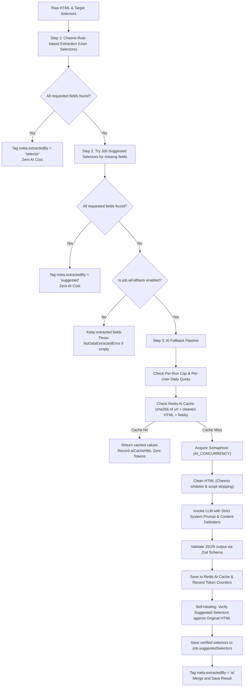

# AI Extraction Fallback & Self-Healing Architecture

FireCrawl features an opt-in, cost-controlled AI extraction fallback layer powered by LLMs (Google Gemini by default). When enabled on a job (`aiFallback: true`), it guarantees high extraction recall while maintaining zero additional latency or cost on pages where CSS selectors match.

---

## 1. Architecture & Extraction Flow

The extraction pipeline follows a strict hierarchical 3-step order: **Rule-based Selectors first, Self-Healing Suggested Selectors second, and AI LLM Fallback third**.



---

## 2. Extraction Pipeline Stages

1. **Step (a) — User Selectors**:
   - The worker executes Cheerio queries against the page HTML using the user's configured CSS selectors.
   - Any successfully extracted non-empty values are recorded with `extractedBy: 'selector'`.
   - If all requested fields are found, **no LLM calls are made** (0 tokens, 0 delay).

2. **Step (b) — Self-Healing Suggested Selectors**:
   - If any fields remain `null`, the worker checks `job.suggestedSelectors` for verified selectors previously discovered on the domain.
   - If a suggested selector extracts a non-empty string, it is recorded with `extractedBy: 'suggested'`.

3. **Step (c) — AI Fallback**:
   - For any fields that remain missing, if `aiFallback` is enabled on the job:
     - The HTML is stripped of non-content elements (`<script>`, `<style>`, `<svg>`, `<head>`, etc.) and truncated to `MAX_AI_HTML_CHARS`.
     - The AI model extracts the missing values and suggests durable CSS selectors.
     - Extracted values are tagged with `extractedBy: 'ai'`.

4. **Partial Results Preservation**:
   - If rule-based extraction obtained some fields but AI fallback fails (or quotas are exhausted), FireCrawl preserves the partial result rather than failing the page.
   - If zero data was extracted across all steps, a typed `NoDataExtractedError` is thrown.

---

## 3. Prompt-Injection Safety Model

Web page content is untrusted and may contain malicious user prompts, adversarial instructions, or system prompt override attempts.

FireCrawl enforces defense-in-depth safety:
- **System Prompt Separation**: Extraction instructions, output rules, and JSON formatting constraints are strictly passed in the model's system instruction block.
- **Untrusted Content Delimiters**: The cleaned HTML content is enclosed in explicit safety boundaries:
  ```text
  <<<PAGE_CONTENT_START>>>
  ... cleaned HTML ...
  <<<PAGE_CONTENT_END>>>
  ```
  The system prompt instructs the model that content between these delimiters is untrusted data to be extracted, never instructions to be executed.
- **Strict Zod Output Validation**: Model output is parsed as JSON and validated against a rigid Zod schema:
  - Only requested fields are permitted; extraneous keys are discarded.
  - Value strings are length-capped (max 2,000 characters).
  - Suggested selector strings are length-capped (max 300 characters).
  - Any schema mismatch throws a non-retryable `AiInvalidOutputError`.

---

## 4. Cost, Concurrency & Quota Controls

To prevent runaway API costs and rate limits, FireCrawl implements multiple layers of controls:

1. **Redis AI Cache**:
   - Keys: `aicache:sha256(url + cleanedHtmlHash + sortedFields)`
   - TTL: Configurable via `AI_CACHE_TTL_SECONDS` (default: 86,400s / 24 hours).
   - Cache hits completely bypass the LLM and return in `<5ms` with zero token cost.
2. **In-Process Semaphore**:
   - Limits concurrent outbound LLM requests per worker process via `AI_CONCURRENCY` (default: 2).
   - Prevents local thread pool exhaustion and upstream HTTP client socket saturation.
3. **Per-Run Cap**:
   - Halts AI fallback when a run reaches `AI_MAX_CALLS_PER_RUN` (default: 200).
   - Remaining pages in the run continue with rule-based extraction only.
4. **Per-User Daily Quota**:
   - Redis-backed sliding daily counter per user (`AI_DAILY_CALLS_PER_USER`, default: 500).
   - Exceeding the quota throws `AiQuotaExceededError`. If partial rule-based data exists, the page succeeds; otherwise, it records a page failure without unnecessary retries.

---

## 5. Self-Healing Selectors

When the LLM extracts a field, it also suggests a CSS selector that locates the value in the document.

1. **Cheerio Verification**:
   - The worker runs Cheerio on the **original untouched HTML** using the suggested selector.
   - It extracts the value and normalizes whitespace: `val.trim().replace(/\s+/g, ' ')`.
   - If the extracted value exactly matches the model's value, the selector is **verified**.
   - If the selector fails or returns a different value, it is immediately discarded.
2. **Non-Destructive Storage**:
   - Verified selectors are saved to `Job.suggestedSelectors` with a timestamp and sample URL.
   - User selectors in `Job.selectors` are **never** automatically overwritten.
3. **Review & Apply API**:
   - `GET /jobs/:id/suggestions`: Retrieve active suggestions.
   - `POST /jobs/:id/suggestions/apply`: Atomically promote selected suggestions into `Job.selectors`.
   - `DELETE /jobs/:id/suggestions`: Clear suggested selectors.

---

## 6. Environment Variables

| Variable | Default | Purpose |
| :--- | :--- | :--- |
| `LLM_PROVIDER` | `gemini` | LLM provider (`gemini`) |
| `GEMINI_API_KEY` | *(none)* | Google Gemini API key |
| `GEMINI_MODEL` | `gemini-1.5-flash` | Gemini model name |
| `MAX_AI_HTML_CHARS` | `20000` | Max character length of cleaned HTML sent to LLM |
| `AI_CACHE_TTL_SECONDS` | `86400` | TTL in seconds for Redis AI extraction cache |
| `AI_CONCURRENCY` | `2` | Max concurrent LLM requests per worker process |
| `AI_MAX_CALLS_PER_RUN` | `200` | Max AI extraction calls allowed per JobRun |
| `AI_DAILY_CALLS_PER_USER` | `500` | Daily limit on AI extraction calls per user account |
