# Architecture & Working Diagrams

FireCrawl is a high-throughput, fault-tolerant web scraping and structured data extraction engine built with Node.js, Express, BullMQ, Redis, MongoDB, and React. It features an automated **rule-based extraction pipeline**, an **opt-in AI fallback with self-healing CSS selectors**, and a **sub-250ms real-time event streaming layer**.

---

## Table of Contents
1. [High-Level System Architecture](#1-high-level-system-architecture)
2. [End-to-End Scraping Pipeline Flowchart](#2-end-to-end-scraping-pipeline-flowchart)
3. [Real-Time WebSocket Streaming Sequence](#3-real-time-websocket-streaming-sequence)
4. [Self-Healing Selector Lifecycle](#4-self-healing-selector-lifecycle)
5. [Database Data Models & Relationships](#5-database-data-models--relationships)
6. [Interactive UI Walkthrough & Screenshot Gallery](#6-interactive-ui-walkthrough--screenshot-gallery)

---

## 1. High-Level System Architecture

The following diagram illustrates the interaction between the frontend client, backend API gateway, BullMQ job queues, distributed worker pool, Redis caching and pub/sub layer, AI fallback service, and MongoDB persistence.

```mermaid
flowchart TB
    subgraph ClientLayer["Frontend Client (React + Vite + Tailwind)"]
        UI["SPA Dashboard (Jobs, Detail, Stats)"]
        SocketHook["useRunProgress Hook (Socket.io Client)"]
    end

    subgraph ServerLayer["API Gateway (Express.js)"]
        Auth["Auth & JWT Middleware"]
        JobRoutes["Job & Run Controllers"]
        StatsRoutes["Stats & Analytics Aggregator"]
        SocketServer["Socket.io Server (@socket.io/redis-adapter)"]
    end

    subgraph MessageLayer["Redis (In-Memory Infrastructure)"]
        BullQueue["BullMQ Job Queue ('scrape-queue')"]
        HtmlCache["SHA-256 HTML Cache (TTL: 1 hour)"]
        PubSub["Pub/Sub Channel ('scrape:events')"]
    end

    subgraph WorkerLayer["Distributed Worker Engine"]
        Processor["Queue Processor"]
        CheerioScraper["Rule-Based Scraper (Cheerio)"]
        AiFallbackEngine["AI Fallback Engine (Gemini Flash)"]
        ResultWriter["Batched Result Writer (25 docs / 200ms)"]
        EventThrottle["Event Throttle & Publisher (250ms Buffer)"]
    end

    subgraph StorageLayer["Persistence (MongoDB)"]
        MongoUsers[("Users Collection")]
        MongoJobs[("Jobs Collection")]
        MongoRuns[("JobRuns Collection")]
        MongoResults[("Results Collection")]
    end

    %% Client to Server
    UI -->|REST API Requests (JWT)| Auth
    Auth --> JobRoutes
    Auth --> StatsRoutes
    SocketHook <-->|WebSocket Events| SocketServer

    %% Server to Redis & Mongo
    JobRoutes -->|Enqueue Jobs| BullQueue
    JobRoutes --> MongoJobs
    StatsRoutes --> MongoRuns
    SocketServer <-->|Adapter Sync| PubSub

    %% Worker Execution
    BullQueue --> Processor
    Processor -->|Check Cache| HtmlCache
    Processor --> CheerioScraper
    CheerioScraper -.->|On Missing Fields| AiFallbackEngine
    AiFallbackEngine -->|Reverse Selector Test| CheerioScraper
    AiFallbackEngine -.->|Update Discovered Selectors| MongoJobs
    Processor --> ResultWriter
    ResultWriter -->|Unordered insertMany| MongoResults
    Processor --> EventThrottle
    EventThrottle -->|Publish Batch Events| PubSub
```

---

## 2. End-to-End Scraping Pipeline Flowchart

Every URL processed by the scraping worker moves through a multi-tier pipeline designed for optimal speed, cache reusability, fault isolation, and cost containment.

```mermaid
flowchart TD
    Start([Worker picks up URL job]) --> RobotsCheck{Robots.txt Disallowed?}
    RobotsCheck -- Yes --> BlockRobots[Record RobotsDisallowedError & Increment robotsBlocked]
    BlockRobots --> NextUrl([Finish URL])

    RobotsCheck -- No --> CacheCheck{Force Refresh or Cache Miss?}
    CacheCheck -- Cache Hit --> UseCache[Load HTML from Redis Cache]
    CacheCheck -- Cache Miss / Bypass --> FetchNet[HTTP GET via Axios with Retry Policy]

    FetchNet --> FetchSuccess{HTTP 2xx & < 2MB?}
    FetchSuccess -- Yes --> WriteCache[Store in Redis: htmlcache:sha256]
    WriteCache --> ParseHtml[Parse DOM via Cheerio]
    FetchSuccess -- No / Timeout --> ClassifyErr[Classify Scrape Error & Apply Retry Backoff]
    ClassifyErr --> TerminalCheck{Max Retries Exceeded?}
    TerminalCheck -- No --> FetchNet
    TerminalCheck -- Yes --> RecordFailure[Record in JobRun.failedUrls & failureReasons]
    RecordFailure --> NextUrl

    UseCache --> ParseHtml
    ParseHtml --> RuleExtraction[Extract Fields via CSS Selectors]
    RuleExtraction --> MissingCheck{Any Fields Missing & aiFallback Enabled?}

    MissingCheck -- No (All Found) --> BuildResult[Build Result with extractedBy: 'selector']
    MissingCheck -- Yes --> CleanHtml[Clean DOM: Strip Scripts, Styles, SVG, Hidden Elements]
    CleanHtml --> CallGemini[Invoke Gemini Flash Structured JSON API]

    CallGemini --> ValidateAi{Valid Structured Output?}
    ValidateAi -- No --> FallbackPartial[Keep Partial Selector Fields]
    ValidateAi -- Yes --> ReverseVerify{Suggested Selector Verified on Raw HTML?}
    ReverseVerify -- Verified --> UpdateJobMeta[Store in Job.suggestedSelectors & extractedBy: 'suggested']
    ReverseVerify -- Unverified / Direct --> FallbackAi[extractedBy: 'ai']

    UpdateJobMeta --> BuildResult
    FallbackAi --> BuildResult
    FallbackPartial --> BuildResult

    BuildResult --> BufferWriter[Add to ResultWriter Buffer]
    BufferWriter --> BatchCheck{Buffer >= 25 or Timer >= 200ms?}
    BatchCheck -- Yes --> InsertBatch[Result.insertMany unordered: false]
    InsertBatch --> HandleDups{E11000 Duplicate Key?}
    HandleDups -- Duplicate --> IncDup[Increment duplicatesSkipped & pagesSkipped]
    HandleDups -- Inserted --> IncScraped[Increment pagesScraped]

    IncDup --> RunTracker[Update JobRun State]
    IncScraped --> RunTracker
    RunTracker --> ThrottleCheck{250ms Throttle Elapsed?}
    ThrottleCheck -- Yes --> PublishEvents[Publish page:batch & run:progress to Redis Pub/Sub]
    ThrottleCheck -- No --> BufferEvent[Buffer event for next flush]

    PublishEvents --> CheckRunEnd{All URLs Processed?}
    BufferEvent --> CheckRunEnd
    CheckRunEnd -- No --> NextUrl
    CheckRunEnd -- Yes --> FinalizeRun[Atomic Finalization: Emit run:finished & set status: completed]
```

---

## 3. Real-Time WebSocket Streaming Sequence

To avoid overwhelming client browsers during massive multi-thousand URL scrapes, the worker enforces a **250ms batching throttle** on `page:done` events before publishing over Redis Pub/Sub to the Socket.io gateway.

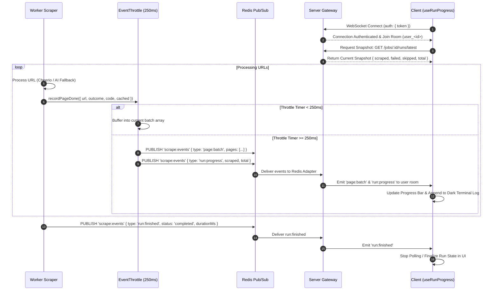

---

## 4. Self-Healing Selector Lifecycle

When website markup shifts and selectors break, FireCrawl's AI fallback bridges the gap while repairing future runs.

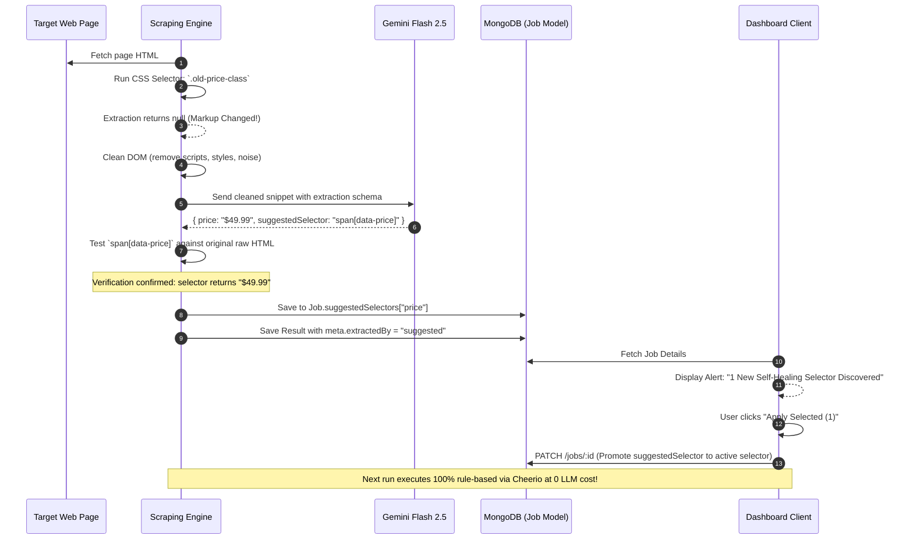

---

## 5. Database Data Models & Relationships

The MongoDB persistence layer uses 4 primary collections linked with indexed relations:

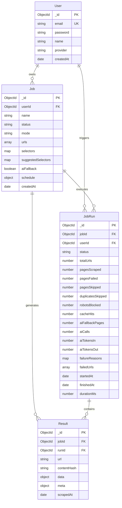

---

## 6. Interactive UI Walkthrough & Screenshot Gallery

All views are fully responsive, styled with Tailwind CSS, and equipped with friendly error states, badges, and progress indicators.

### 6.1 Authentication & Access Control
The entry portal supports secure credential login and one-click Google/GitHub OAuth integrations with JWT token generation and automated refresh handling.

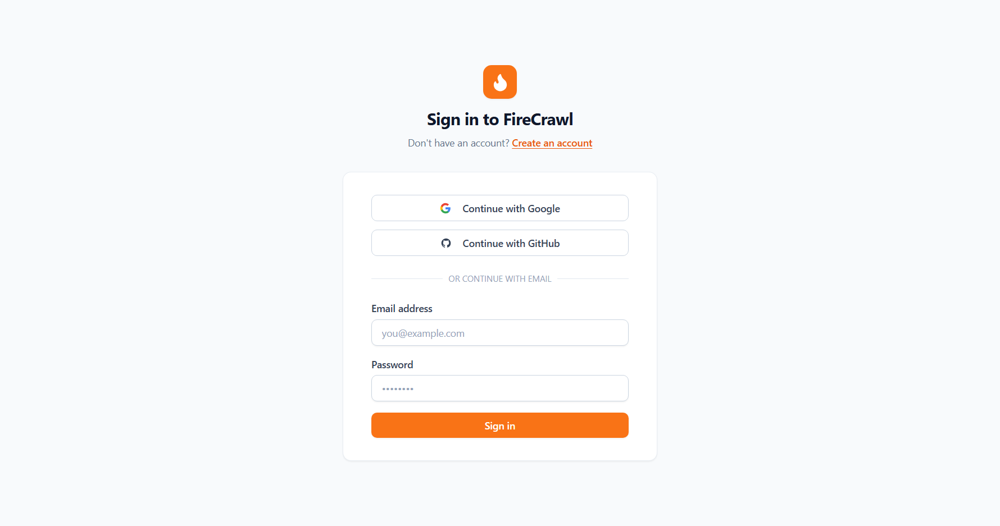

---

### 6.2 Scraping Jobs Overview
A centralized command center displaying all configured scraping jobs, operational statuses (`IDLE`, `RUNNING`, `QUEUED`, `COMPLETED`), URL counts, creation dates, and action controls for manual execution, cache-bypassing force refreshes, and deletion.

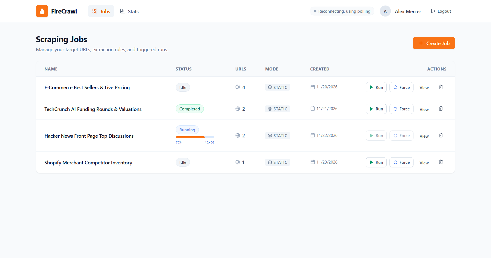

---

### 6.3 Job Creation & AI Fallback Configuration
An interactive job configuration form featuring dynamic URL parsing with real-time validation counters, key-value CSS selector mappings, and an opt-in toggle for Gemini AI fallback extraction.

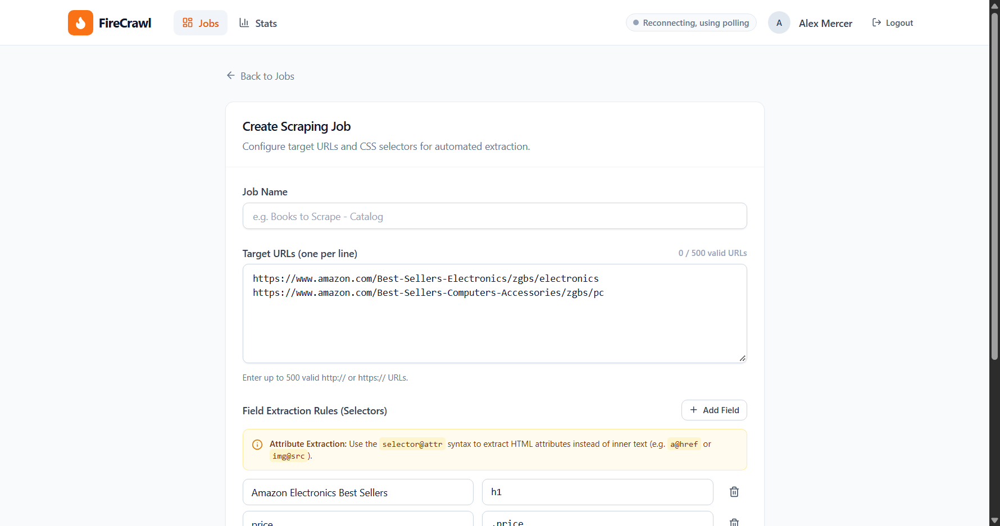

---

### 6.4 Extracted Tabular Results & Provenance Badging
The primary data exploration view displays scraped records with individual field provenance tags (`selector`, `suggested`, `ai`), real-time search filtering, and one-click sanitized CSV/JSON streaming export.

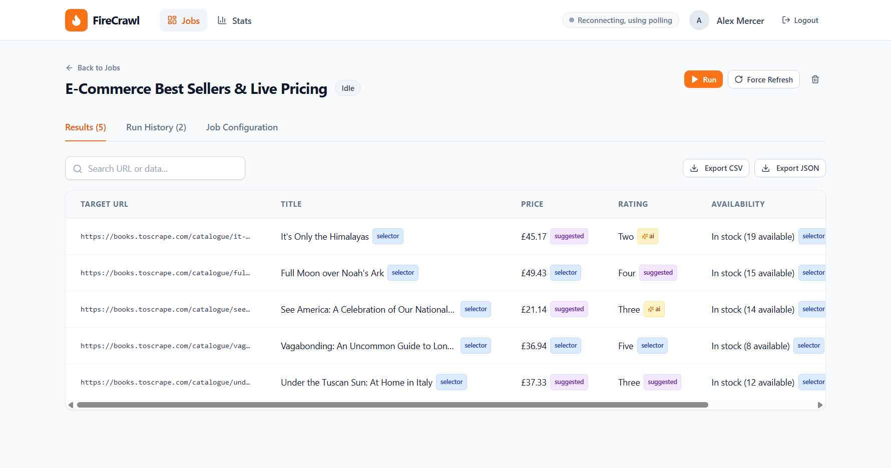

---

### 6.5 Execution Diagnostics & Run History
An expandable diagnostic view tracking run execution histories, execution latencies, scrape/fail/skip counts, Redis cache hits, AI token expenditures, and full error breakdown cards for failed targets.

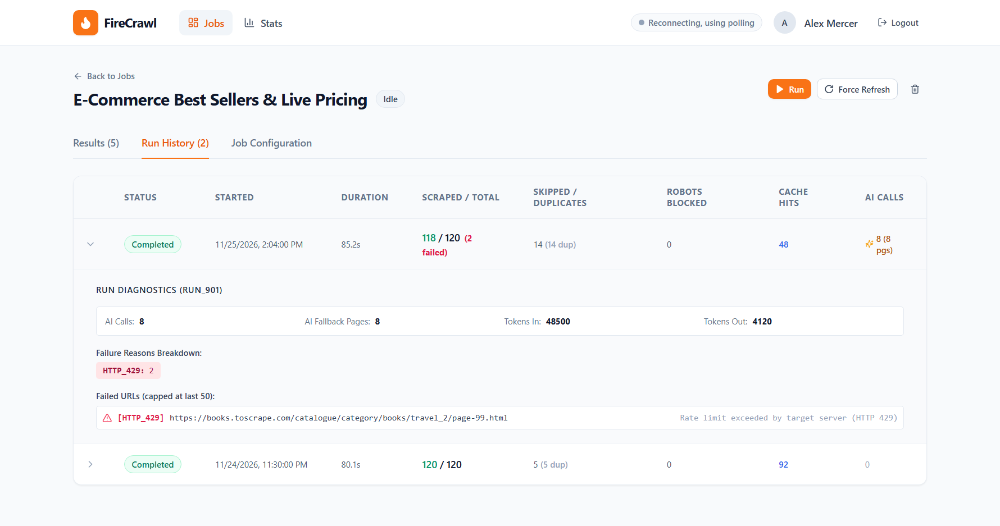

---

### 6.6 Real-Time Progress & Streaming Terminal
Active jobs feature live Socket.io streaming progress bars, percent counters, connection mode pills (`Realtime (Socket.io)` vs `Polling Fallback`), and real-time page outcome updates.

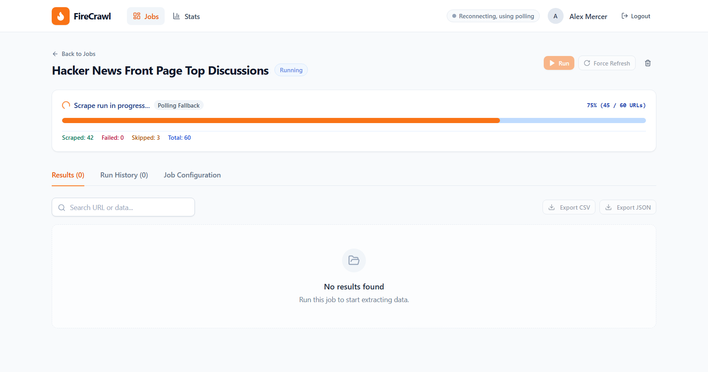

---

### 6.7 Self-Healing Selector Management
The Job Configuration view allows developers to inspect CSS selectors discovered by AI, review the sample URLs and verification timestamps, and promote them to active selectors with a single click.

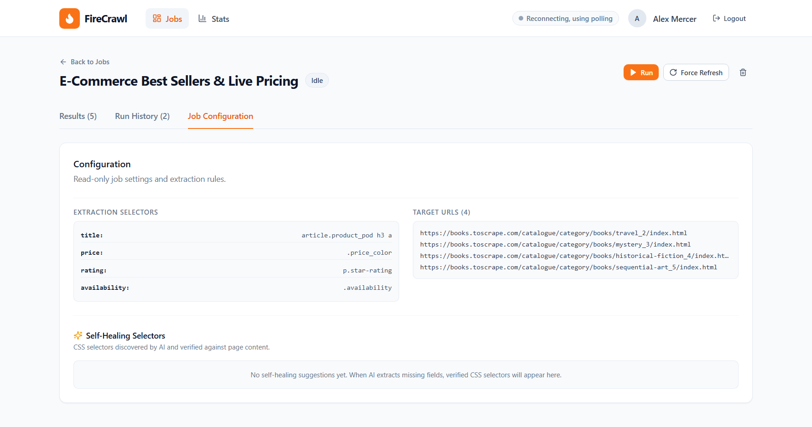

---

### 6.8 Platform Analytics & AI Cost Performance
Comprehensive performance analytics showing 14-day scraping throughput charts, global success and cache hit rates, failure code breakdowns, and AI self-healing efficiency statistics.

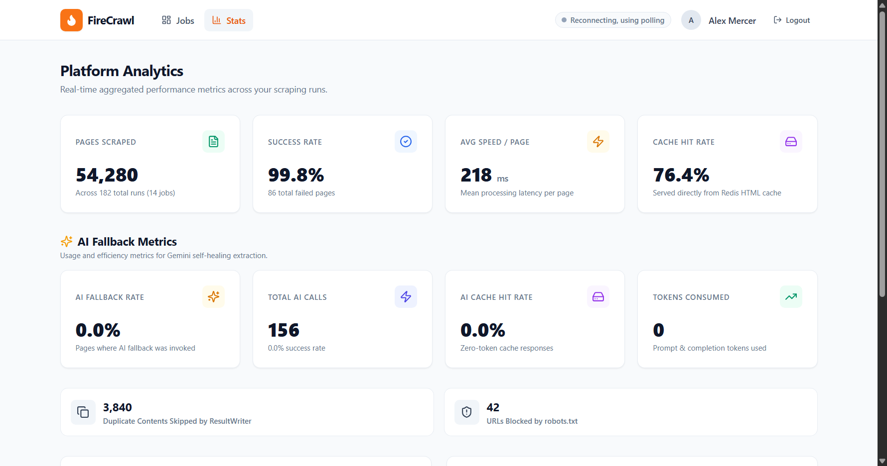
