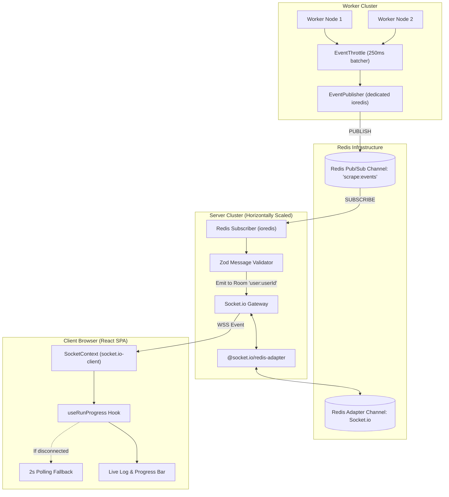

# Realtime Progress Architecture with Socket.io

FireCrawl features a resilient, distributed realtime progress streaming system for active web scraping jobs. It decouples scraping worker nodes from client-facing API instances through Redis pub/sub and delivers scoped events directly to users' authenticated browser sessions.

---

## Architecture Diagram

---

## Event Catalog

All events emitted to the Redis channel `scrape:events` share a common envelope and are validated with Zod before being dispatched to the user room `user:<userId>`:

| Event Type | Direction | Payload Shape | Description |
| :--- | :--- | :--- | :--- |
| `run:started` | Worker &rarr; Server &rarr; Client | `{ type: 'run:started', userId, jobId, runId, totalUrls, ts }` | Emitted once when a job run transitions from `queued` to `running`. |
| `run:progress` | Worker &rarr; Server &rarr; Client | `{ type: 'run:progress', userId, jobId, runId, scraped, failed, skipped, total, cacheHits, ts }` | Coalesced progress snapshot emitted at most every 250ms per run. |
| `page:done` | Worker &rarr; Server &rarr; Client | `{ type: 'page:done', userId, jobId, runId, url, outcome, code?, cached?, ts }` | Single page terminal outcome (scraped, skipped, or failed). |
| `page:batch` | Worker &rarr; Server &rarr; Client | `{ type: 'page:batch', userId, jobId, runId, pages: Array<PageDone>, ts }` | Batched array of terminal outcomes flushed at most every 250ms. |
| `run:finished` | Worker &rarr; Server &rarr; Client | `{ type: 'run:finished', userId, jobId, runId, status, durationMs, scraped, failed, skipped, total, ts }` | Exactly-once finalization event emitted when all URLs terminate. |

---

## Reconnect & Resync Strategy

Realtime events are **best-effort**. If a network glitch occurs or the client temporarily disconnects, FireCrawl guarantees consistency through a dual-channel resync strategy:

1. **REST Snapshot Synchronization**:
   - On initial mount and whenever the socket connects or reconnects, `useRunProgress` fetches the authoritative run state via `GET /jobs/:id/runs/latest`.
   - The snapshot reconciles all counters (`pagesScraped`, `pagesFailed`, `pagesSkipped`, `totalUrls`, `status`) and ensures no dropped events cause stale UI state.
2. **Automatic Fallback Polling**:
   - If the socket disconnects (e.g., firewall block or network drop), `useRunProgress` seamlessly falls back to 2-second REST polling.
   - Polling automatically pauses when the browser tab is hidden (`document.hidden`) to save bandwidth and battery.
   - When the socket reconnects, polling immediately halts and realtime streaming resumes.

---

## Security & Isolation

- **Authentication via Handshake**:
  - The JWT is read strictly from `socket.handshake.auth.token`.
  - Tokens passed in the query string (`?token=...`) are explicitly **rejected** to prevent token leakage in proxy logs or browser history.
- **Strict Room Isolation**:
  - Authenticated sockets automatically join `user:<userId>` only.
  - Sockets are prevented from joining arbitrary or client-requested rooms, ensuring User A can never intercept User B's events.
  - Sockets ignore events where `event.jobId` does not match the active view.
- **Connection Limits**:
  - Concurrency is throttled to `MAX_SOCKETS_PER_USER` (default 10) to guard against connection exhaustion attacks.
- **Input Neutralization**:
  - Client-sent custom events are rate-limited and ignored, preventing unexpected message injection.
- **Malformed Message Dropping**:
  - The Redis subscriber schema validates incoming pub/sub strings via Zod. Invalid JSON or malformed structures are logged and dropped without crashing the process.
